# Multi-agent flight disruption negotiation

> **Hackathon submission** for **Autonomous SG 2026** at the National University of Singapore (NUS): a 6-hour sprint hackathon powered by **Claude by Anthropic**. This competed in the AI & Aerospace track for Airbus Challenge #2.

When weather or a late aircraft disrupts a flight, air traffic control, the pilot and ground operations each have constraints the others can't see, and today they reconcile them by phone. This project gives each of them an independent Claude agent. The three agents negotiate a recovery plan for a **real 2015 US flight disruption** in at most three rounds. Code computes every number and enforces every safety rule, a deterministic non-AI fallback decides when the agents don't agree, and a human duty manager approves the result.

**Results on 31 real disruptions** ([full evaluation](docs/RESULTS.md)): total cost **$69,568 → $28,002** against today's process, **0** safety-rule violations reaching the duty manager (today's process breaks a hard rule in 6), consensus in **21 of 32** runs with scripted votes (**26 of 30** in the team's separate live-Claude batch, `results/eval_summary.json`), at the price of **+6.6 min** average delay.

<!-- Screenshot: add docs/images/console.png (app_prime.py after "Find a recovery plan") -->

## How it works

```mermaid
flowchart LR
    EV([Real 2015 delayed flight]) --> W["Code builds each agent's world<br/>from the row + workbook limits"]
    subgraph NEG["Mediator: pure code, max 3 rounds"]
        R1["Round 1<br/>ATC · Pilot · Ground propose"] --> CK{{"Safety checker<br/>drops unsafe plans"}}
        CK --> R2["Round 2<br/>agents score the shortlist"]
        R2 --> PK["Pick: Nash product<br/>of scores × cost"]
        PK --> R3["Round 3<br/>agents accept / reject"]
    end
    W --> R1
    R3 -- all accept --> OUT["Recommended plan<br/>+ decision record"]
    R3 -- any reject --> FB["Fallback: cheapest safe plan<br/>(no AI)"] --> OUT
    OUT --> HUM{{Duty manager<br/>approves or rejects}}

    classDef llm fill:#fde0e3,stroke:#9d0012,color:#51000a
    classDef code fill:#dcdcfa,stroke:#3333c4,color:#101086
    class R3 llm
    class W,CK,R1,R2,PK,FB code
```



*Blue = deterministic code. Red = Claude in live mode (three separate calls, one per agent). Rounds 1–2 currently use each agent's code-side ranking; see [architecture §8](docs/architecture.md#8-where-the-llm-is-used-and-where-it-isnt).*

## Quickstart

```bash
python3 -m venv .venv && .venv/bin/pip install -r requirements.txt

.venv/bin/streamlit run app_prime.py         # duty manager console (replays saved runs, no API key needed)
.venv/bin/python -m mediator.run             # one negotiation in the terminal, no LLM calls
.venv/bin/python -m evaluation.evaluate      # 32-row evaluation, writes docs/RESULTS.md (~30 s, no LLM calls)
```

For live Claude votes, put `ANTHROPIC_API_KEY` in `.env.local` (see `.env.example`), then run `.venv/bin/python -m mediator.run --live` or turn off **Replay saved run** in the console. Each run writes a JSONL consensus log and a plain-English decision record to `logs/`.

## Guarantees

- **Safety is a filter, never a price.** Fuel, crew duty, runway capacity, wake separation and gate rules are checked in code; a plan that breaks one is removed before it's costed ([ADR-0002](docs/adr/0002-safety-as-filter-not-cost.md)).
- **Bounded:** exactly 3 rounds, at most 9 agent calls per disruption; malformed agent output is retried once, then counts as a reject ([ADR-0003](docs/adr/0003-code-mediator-fixed-three-rounds.md)).
- **Roles never merged:** ATC, Pilot and Ground are separate agents with separate prompts and private facts.
- **No hindsight:** agents never see the dataset's actual-outcome columns; only the evaluation reads them.
- **A human decides:** a cancellation is only ever a recommendation.

## Limitations

Stated in full, with causes and fixes, in [RESULTS.md §5](docs/RESULTS.md). In short:

- The cost model doesn't yet count passengers who miss connections because of a late arrival.
- "Depart on time and hold with extra fuel" is never available: ATC sizes extra fuel against the wrong fuel limit.
- Weather rarely reduces capacity at medium-sized hubs, so those rows show little or no delay.
- In the evaluation, the agents agree on the least-cost solver's plan 29 times in 31: the saving comes mainly from shared code-based checks and costs, not from negotiation beating an optimiser.
- Gate occupancy, filler traffic, connecting passenger counts and crew times are synthetic (and labelled).

## Documentation

| Doc | For |
|---|---|
| [docs/usage.md](docs/usage.md) | Duty managers: running the console and reading the outcome |
| [docs/architecture.md](docs/architecture.md) | Developers and reviewers: components, sequence and flow diagrams, safety rules, cost model, glossary |
| [docs/adr/](docs/adr/README.md) | Why: Nash product pick, safety as filter, code mediator with three rounds |
| [docs/RESULTS.md](docs/RESULTS.md) | Evaluation: baselines, cost savings by decision, failures and bugs |
| [docs/challenge-2-brief.md](docs/challenge-2-brief.md) | The Airbus brief and judging rubric |
| [docs/challenge-2-framing.md](docs/challenge-2-framing.md) | The team's design framing and [key citations](docs/challenge-2-framing.md#key-citations) from its literature review |

## Repository layout

| Path | Contents |
|---|---|
| `atc-agent/` | ATC agent: arrival slots, wake separation, hourly capacity, background flights |
| `agents/` | Pilot agent: fuel to the must-divert point, crew duty, connections, alternate |
| `ground_agent/` | Ground agent: gates, turnaround, ground crew |
| `mediator/` | 3-round negotiation, safety checks, cost, consensus log, decision record |
| `fallback/` | Deterministic least-cost solver (also the evaluation baseline) |
| `evaluation/` | Batch evaluation against status-quo and single-agent baselines |
| `app_prime.py`, `app.py`, `middleman.py` | Streamlit console and its bridge to the mediator |
| `data/raw/` | DOT 2015 flight data and the organiser's operational-limits workbook |

## Data and assumptions

- **Real:** the US DOT 2015 flight-delay dataset row (schedule, delay cause and magnitude), other delayed arrivals at the same airport, airport coordinates.
- **Limits:** the organiser workbook `data/raw/challenge2/challenge-2-operational-constraints.xlsx` (gates, turnaround, fuel, crew, runway capacity, wake separation).
- **Synthetic, seeded and labelled:** gate occupancy, filler arrivals (the dataset contains only delayed flights), connecting passenger counts, crew report times.

## How this was built

- **The team** (4 people: Ryan Chua, cibichandar, jon, vishnuroxx) did the problem framing, the literature review ([key citations](docs/challenge-2-framing.md#key-citations)), the system architecture and every design decision: the agent roles and contract, the three-round protocol, safety as a filter, the Nash product pick and the evaluation design.
- **Claude** (via Claude Code) wrote the implementation under the team's direction: the agents, mediator, checker, fallback, UI, evaluation and these documents. The design-decision records in [docs/adr/](docs/adr/README.md) were written up afterwards from the team's decisions.
- **At runtime**, the three agents are Claude Sonnet (`claude-sonnet-5-5`), called through the Anthropic API.
