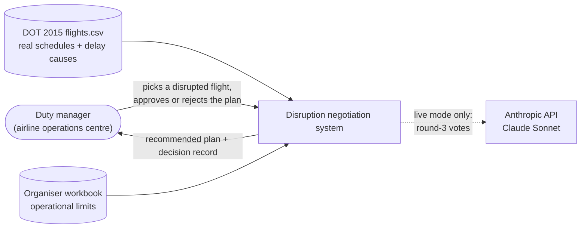
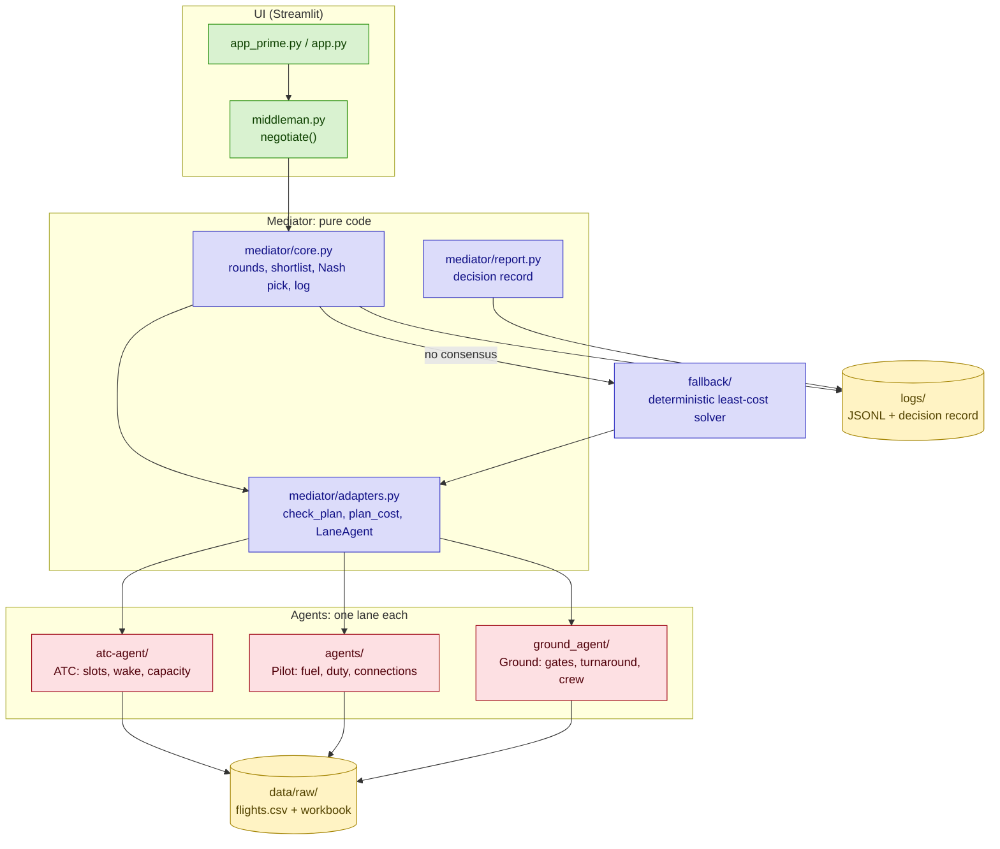
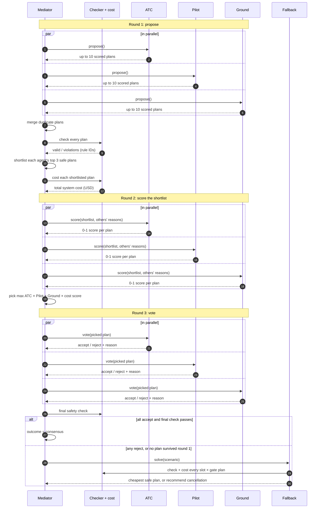
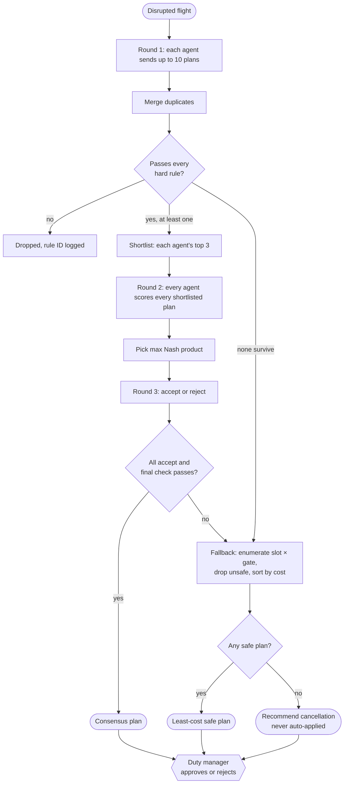
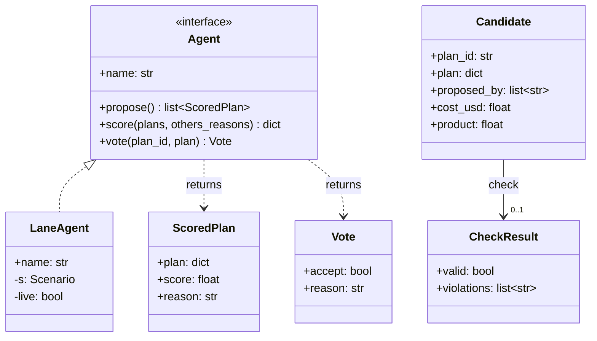

# Architecture

Built as a submission to Autonomous SG 2026 (NUS), a 6-hour sprint hackathon powered by Claude by Anthropic; see [How this was built](../README.md#how-this-was-built).

How the system turns one delayed flight into a safety-checked recovery plan that a duty manager approves. For the design decisions behind it, see the [decision records](adr/README.md). For measured results, see [RESULTS.md](RESULTS.md).

- [1. Context](#1-context)
- [2. Components](#2-components)
- [3. One negotiation, step by step](#3-one-negotiation-step-by-step)
- [4. How a plan is picked](#4-how-a-plan-is-picked)
- [5. The agent contract](#5-the-agent-contract)
- [6. Safety rules](#6-safety-rules)
- [7. Cost model](#7-cost-model)
- [8. Where the LLM is used, and where it isn't](#8-where-the-llm-is-used-and-where-it-isnt)
- [9. Traceability](#9-traceability)
- [10. Glossary](#10-glossary)

## 1. Context

The duty manager is the only human in the loop and makes the final call. The system reads one real 2015 delayed flight plus the organiser's limits (gates, turnaround, fuel, crew, runway capacity). It never reads outcome columns such as `ARRIVAL_DELAY`; those are used only by the evaluation. Claude is called only in live mode. The default dry run makes no API calls.

## 2. Components

*Colours: green = UI, blue = deterministic code that decides, red = agent lanes, gold = data. Arrows show "calls" or "reads/writes". The two UI files are alternative front ends over the same `negotiate()`.*

| Component | Folder | Responsibility |
|---|---|---|
| ATC lane | `atc-agent/` | Builds the arrival menu: every reachable landing slot, spaced by hourly capacity and wake separation, with focal delay, knock-on delay to other arrivals and cost. Votes on the picked plan. |
| Pilot lane | `agents/` | Fuel budget to the must-divert point, flight-crew duty, onward connections, alternate airport. Ranks plans in strict priority order: no diversion, no minimum fuel, fewest stranded passengers. |
| Ground lane | `ground_agent/` | Gate timelines, minimum turnaround, gate-change notice, ground-crew overtime. |
| Mediator | `mediator/` | Runs the 3 rounds, merges duplicate plans, runs the checker, shortlists, picks, records every step. Never calls an LLM. |
| Fallback | `fallback/` | Enumerates every slot × gate plan, drops unsafe ones, returns the cheapest, or recommends cancellation. Also the evaluation baseline. |
| UI | `app_prime.py`, `app.py`, `middleman.py` | Pick a flight, replay or run a negotiation, read the recommendation, approve or reject. |
| Evaluation | `evaluation/` | Batch run on 32 stratified real rows against status-quo and single-agent baselines. Writes [RESULTS.md](RESULTS.md). |

## 3. One negotiation, step by step

*Only the mediator is expanded; agents, checker and fallback are black boxes. Logging is left out: every step above writes one line to the consensus log. `par` blocks run concurrently with `asyncio.gather`. In dry-run and live modes alike, rounds 1–2 use each lane's code-side ranking; in live mode, round 3 is three separate Claude calls (see [§8](#8-where-the-llm-is-used-and-where-it-isnt)).*

## 4. How a plan is picked

*Unsafe plans never reach round 2 or the fallback's answer. The cancellation branch is a recommendation to a human, not an action. Why the Nash product: [ADR-001](adr/0001-nash-product-pick.md). Why safety is a filter, not a cost: [ADR-002](adr/0002-safety-as-filter-not-cost.md).*

## 5. The agent contract

Agents share only messages; each keeps its own facts, constraints and ranking ([agent-alignment.md](agent-alignment.md)). The mediator speaks to every lane through one interface:

*`LaneAgent` (`mediator/adapters.py`) wraps each lane's own code and Claude agent. Score dictionaries on `Candidate` are left out.*

A plan has the same six fields everywhere:

| Field | Type | Owner | Meaning |
|---|---|---|---|
| `arrival_slot` | `"HH:MM"` | ATC | Landing time at the destination |
| `ground_delay_min` | int | ATC / Pilot | Minutes held at the origin before take-off |
| `holding_min` | int | ATC / Pilot | Minutes holding in the air |
| `extra_fuel_min` | int | Pilot | Extra holding fuel loaded before departure |
| `gate` | str | Ground | Arrival gate |
| `divert` | bool | Pilot | Divert to the alternate airport |

## 6. Safety rules

Every rule is code. A plan that breaks a hard rule is removed before it is priced ([ADR-002](adr/0002-safety-as-filter-not-cost.md)). Limits come from `data/raw/challenge2/challenge-2-operational-constraints.xlsx`; full registry in [rule-registry.md](../atc-agent/agent-spec/agent-contract/rule-registry.md).

| Rule | Limit | Type | Checked by |
|---|---|---|---|
| `C-CAP-1` | Arrivals per hour ≤ cap (cut 30% in weather hours); plan must be on ATC's computed menu | hard | ATC |
| `C-WAKE-1` / `C-SEP-1` | Spacing between landings by wake class | hard | ATC (built into the menu's landing times) |
| `C-FUEL-1` | Holding ≤ fuel available before the must-divert point; the 30-min final reserve is never used | hard | Pilot |
| `C-CREW-2` | Flight crew duty ≤ 13 h | hard | Pilot |
| `C-GATE-1` | Gate free within 30 min of landing for the full turnaround | hard | Ground |
| `C-GATE-2` | Gate change needs ≥ 20 min notice | hard | Ground |
| `C-TURN-1` | Turnaround ≥ airport minimum | hard | Ground |
| `C-CREW-1` | Ground crew 8 h shift; overtime at 1.5× | soft (cost) | Ground |
| `MINIMUM_FUEL` flag | Fuel margin < 10 min | flag | Pilot |

## 7. Cost model

`plan_cost` in `mediator/adapters.py` = ATC part + Ground part. Weights are fixed in code and labelled with their source.

| Item | Rate | Source |
|---|---|---|
| Ground delay | $49/min | Half the airborne rate (Eurocontrol: airborne ≈ 2× ground) |
| Airborne holding | $98/min | Airlines for America 2025 block-minute cost |
| Extra fuel loaded | $5/min | Synthetic |
| Knock-on delay to other arrivals | $98/min | Assumption: absorbed airborne |
| Gate change | $400 | Synthetic |
| Waiting for an occupied gate | $69/min | $49 delay + $20 passengers onboard (assumption) |
| Ground-crew overtime | $5.25/min | Workbook 1.5× on a synthetic $3.50/min |
| Avoidable delay to the aircraft's next flight | $49/min | Assumption |
| Missed connection from a gate change | $200/passenger | Synthetic |

Not in the cost: hard rules (they filter instead), passengers missing connections because of a late arrival (a known gap, see [RESULTS.md §5](RESULTS.md)), the original delay itself (equal across plans) and CO2 (reported, not priced).

## 8. Where the LLM is used, and where it isn't

| Step | Dry run (default) | Live mode (`--live`) |
|---|---|---|
| Round 1 proposals | Each lane's code ranking | Same |
| Round 2 scores | Each lane's code ranking | Same |
| Round 3 votes | Each lane's scripted policy | 3 separate Claude Sonnet calls (`claude-sonnet-5-5`), one per agent |
| Constraint checks, costs, pick, termination | Code | Code |
| Fallback | Code | Code |
| Decision record | Code template | Code template |

Every LLM output is validated against a schema (`messages.parse` with Pydantic). The lanes then re-check it in code: the Pilot lane refuses to send an accept of an unsafe plan whatever the model says, and an output that fails validation is retried once, then treated as a reject. Token cost and latency per live run are not yet measured.

## 9. Traceability

- **Consensus log:** `logs/mediator-<id>-<run>.jsonl`, one line per step: scenario and rules applied, every proposal, every check with rule IDs, shortlist with costs, every score with its reason, the pick and its ranking, votes, final check, outcome, fallback.
- **Decision record:** `logs/mediator-<id>-<run>.md`, the same log in plain English for the duty manager.
- **Reproducibility:** fixed seeds for every synthetic input; dry runs are deterministic. The UI replays saved runs from `results/<row_id>.json`.
- **Approval:** the UI's Approve / Reject is held in the UI session; it is not yet written to the consensus log.

## 10. Glossary

| Term | Meaning |
|---|---|
| Duty manager | Airline operations centre staff member who owns the recovery decision |
| Focal flight | The disrupted flight being negotiated |
| Background flights | Other arrivals at the same airport and hour; they occupy slots and absorb knock-on delay but don't negotiate |
| Ground delay | Holding the aircraft at the origin before take-off; no fuel burned |
| Holding | Circling near the destination before landing; burns fuel |
| Must-divert point | The fuel level at which the aircraft must leave for its alternate airport |
| Knock-on delay | Delay pushed onto other flights by this flight's plan |
| Nash product | ATC score × Pilot score × Ground score × cost score; the mediator picks the highest |
| Fallback | Deterministic, non-AI solver used when agents don't agree |
| Status quo (B0) | Our model of today's process: first-come-first-served ground delay, keep the scheduled gate |
| Dry run | Run with no LLM calls; scripted votes |
| Hindsight columns | Outcome fields in the DOT data (actual times and delays) that agents must never see |
